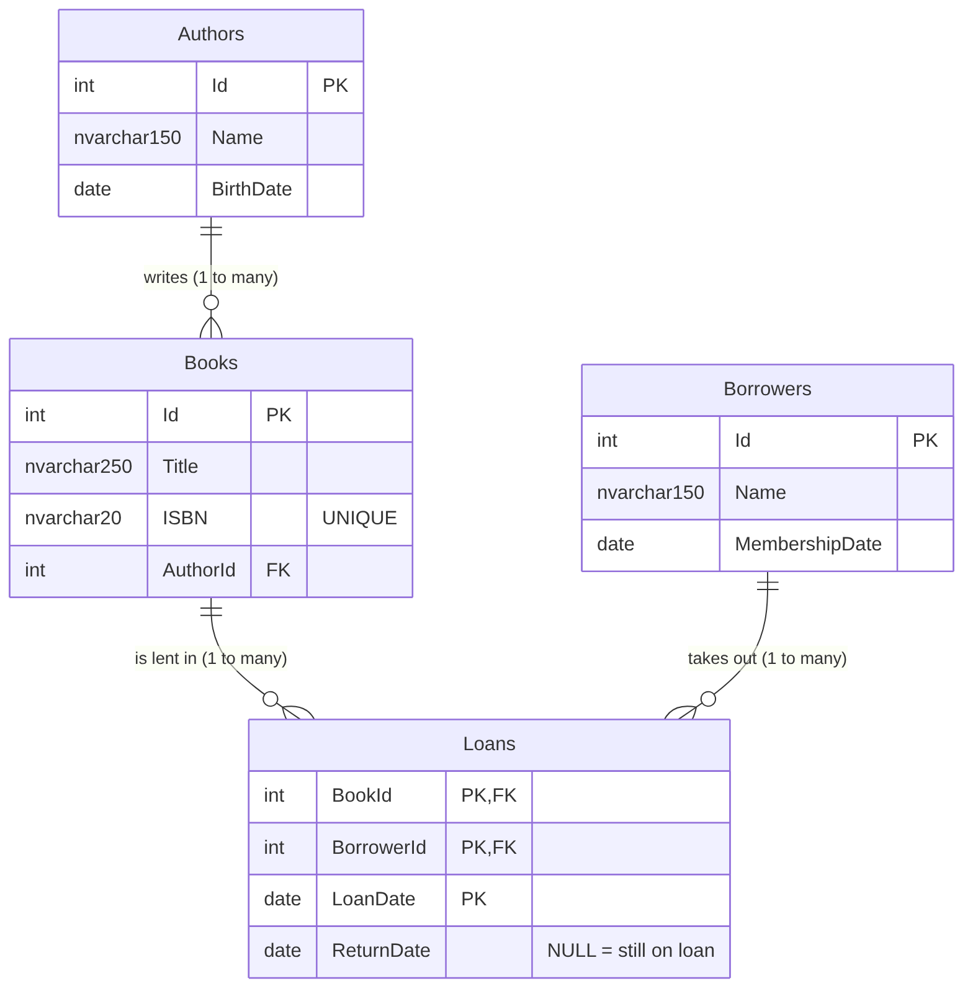

# Library System (EF Core relationships demo)

A small .NET console app that models a library with Entity Framework Core and shows how
**navigation properties** map relationships.

| Relationship | Entities | How it is mapped |
|---|---|---|
| One-to-Many | Author -> Book | `Author.Books` / `Book.Author` / `Book.AuthorId` |
| Many-to-Many | Book <-> Borrower | explicit join entity `Loan` (with `LoanDate`, `ReturnDate`) plus skip navigations `Book.Borrowers` / `Borrower.Books` |



## Requirements

* .NET SDK 8.0 or newer
* SQL Server. The default connection string uses **LocalDB** (installed with Visual Studio on Windows).
  On another setup, edit `connectionString` at the top of `LibrarySystem/Program.cs`.

## Run

Visual Studio: open `LibrarySystem.sln`, press **F5**.

Command line:

```bash
dotnet run --project LibrarySystem
```

The first run creates the `LibrarySystemDb` database, inserts sample data and prints five demo queries.

## Project layout

```
LibrarySystem/
  Models/    Author, Book, Borrower, Loan   (plain C# classes + navigation properties)
  Data/      LibraryContext (Fluent API mapping), DbSeeder (sample data)
  Program.cs demo queries
docs/        ERD diagram
```

## Using migrations instead of EnsureCreated (optional, recommended for real projects)

```bash
dotnet tool install --global dotnet-ef
dotnet ef migrations add InitialCreate --project LibrarySystem
dotnet ef database update --project LibrarySystem
```

Then replace `db.Database.EnsureCreated();` in `Program.cs` with `db.Database.Migrate();`.

## Design decisions

* **Loan has a composite key `(BookId, BorrowerId, LoanDate)`.** A key of only `(BookId, BorrowerId)` would
  allow each member to borrow a given book once, ever.
* **`DeleteBehavior.Restrict`** on all foreign keys, so deleting an author, book or borrower cannot silently
  wipe catalogue or loan history.
* **Unique index on `Book.ISBN`** and a **check constraint** that `ReturnDate` is not before `LoanDate`.
